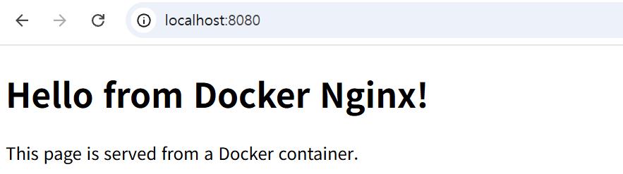
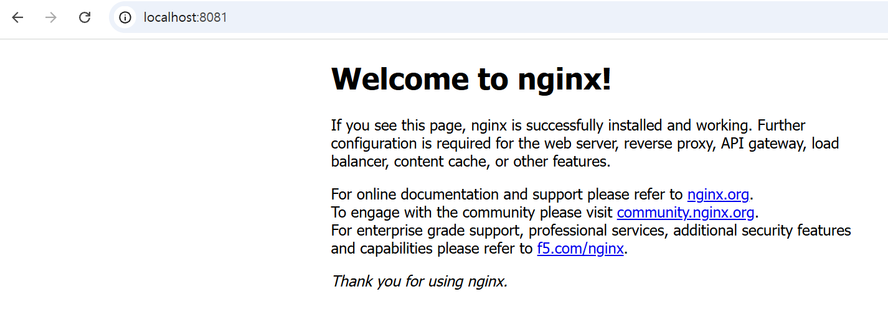
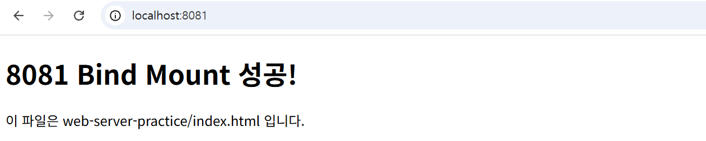

# Dev Workstation Mission

## 1. 프로젝트 개요

이 저장소는 개발 워크스테이션 구축 과제 결과물이다.  
터미널 기본 조작, 파일 권한, Docker 설치/운영, Dockerfile 기반 웹 서버 제작, 포트 매핑, 바인드 마운트, Docker 볼륨, Git/GitHub 연동을 실습하고 기록한다.

## 2. 실행 환경

| 항목 | 내용 |
|---|---|
| OS | Windows |
| Shell/Terminal | PowerShell, Git Bash |
| Editor | VSCode |
| Docker | 추후 기록 |
| Git | 추후 기록 |

## 3. 수행 항목 체크리스트

- [V] 터미널 기본 조작
- [V] 파일/디렉토리 권한 실습
- [V] Docker 설치 점검
- [V] Docker 기본 운영 명령
- [V] hello-world 컨테이너 실행
- [V] ubuntu 컨테이너 실습
- [V] 포트 매핑 접속 확인
- [V] Dockerfile 기반 커스텀 이미지 제작
- [V] 바인드 마운트 반영 확인
- [V] Docker 볼륨 영속성 확인
- [V] Git 설정 Github 연동

## 4. 터미널 조작 로그 기록

이번 단계에서는 Git Bash 터미널을 사용하여 기본 파일/디렉터리 조작 명령어를 실습하였다.  
현재 위치 확인, 목록 확인, 디렉터리 이동, 파일 생성, 내용 확인, 복사, 이름 변경, 삭제 명령을 수행하고 결과를 기록하였다.

---

### 4-1. 현재 위치 확인

```bash
pwd
```

실행 결과:

```bash
/c/Users/사용자명/dev-workstation-mission
```

현재 작업 중인 디렉터리 위치를 확인하였다.

---

### 4-2. 목록 확인

```bash
ls -la
```

실행 결과 :

```bash
total 44
drwxr-xr-x 1 사용자명 1049089     0 Nov 12 12:18 ./
drwxr-xr-x 1 사용자명 1049089     0 Nov 12 12:18 ../
drwxr-xr-x 1 사용자명 1049089     0 Nov 12 13:47 .git/
drwxr-xr-x 1 사용자명 1049089     0 Nov 12 12:18 dockerfile-practice/
drwxr-xr-x 1 사용자명 1049089     0 Nov 12 12:18 permissions-practice/
drwxr-xr-x 1 사용자명1049089     0 Nov 12 12:18 practice/
-rw-r--r-- 1 사용자명 1049089 32507 Nov 12 13:46 README.md
drwxr-xr-x 1 사용자명 1049089     0 Nov 12 12:18 web-server-practice/
```

`ls -la` 명령어를 사용하여 숨김 파일과 디렉터리를 포함한 전체 목록을 확인하였다.

---

### 4-3. 실습용 디렉터리 생성 및 이동

```bash
mkdir terminal-log-practice
cd terminal-log-practice
pwd
```

실행 결과:

```bash
/c/Users/사용자명/dev-workstation-mission/terminal-log-practice
```

`mkdir` 명령어로 실습용 디렉터리를 생성하고, `cd` 명령어로 해당 디렉터리로 이동하였다.

---

### 4-4. 빈 파일 생성

```bash
touch empty.txt
```

`touch` 명령어를 사용하여 빈 파일 `empty.txt`를 생성하였다.

---

### 4-5. 내용이 있는 파일 생성 및 파일 내용 확인

```bash
echo "Terminal command practice" > note.txt
cat note.txt
```

실행 결과:

```bash
Terminal command practice
```

`echo` 명령어로 파일에 내용을 작성하고, `cat` 명령어로 파일 내용을 확인하였다.

---

### 4-6. 숨김 파일 생성 및 목록 확인

```bash
touch .hidden-file
ls -la
```

실행 결과 예시:

```bash
total 5
drwxr-xr-x 1 사용자명 1049089  0 Nov 12 13:59 ./
drwxr-xr-x 1 사용자명  1049089  0 Nov 12 13:57 ../
-rw-r--r-- 1 사용자명  1049089  0 Nov 12 13:59 .hidden-file
-rw-r--r-- 1 사용자명  1049089  0 Nov 12 13:58 empty.txt
-rw-r--r-- 1 사용자명  1049089 26 Nov 12 13:58 note.txt
```

`.`으로 시작하는 파일은 숨김 파일로 취급된다.  
`ls -la` 명령어를 사용하면 숨김 파일까지 확인할 수 있다.

---

### 4-7. 파일 복사

```bash
cp note.txt note-copy.txt
ls -la
```

실행 결과 예시:

```bash
-rw-r--r-- 1 사용자명 1049089 26 Nov 12 13:58 note.txt
-rw-r--r-- 1 사용자명1049089 26 Nov 12 14:00 note-copy.txt
```

`cp` 명령어를 사용하여 `note.txt` 파일을 `note-copy.txt`로 복사하였다.

---

### 4-8. 파일 이동 및 이름 변경

```bash
mv note-copy.txt note-renamed.txt
ls -la
```

실행 결과 예시:

```bash
-rw-r--r-- 1 사용자명 1049089 26 Nov 12 13:58 note.txt
-rw-r--r-- 1 사용자명1049089 26 Nov 12 14:00 note-renamed.txt
```

`mv` 명령어를 사용하여 `note-copy.txt` 파일 이름을 `note-renamed.txt`로 변경하였다.

---

### 4-9. 파일 삭제

```bash
rm empty.txt
ls -la
```

실행 결과 예시:

```bash
drwxr-xr-x 1 사용자명 1049089  0 Nov 12 14:02 ./
drwxr-xr-x 1 사용자명1049089  0 Nov 12 13:57 ../
-rw-r--r-- 1 사용자명1049089  0 Nov 12 13:59 .hidden-file
-rw-r--r-- 1 사용자명1049089 26 Nov 12 13:58 note.txt
-rw-r--r-- 1 사용자명1049089 26 Nov 12 14:00 note-renamed.txt
```

`rm` 명령어를 사용하여 `empty.txt` 파일을 삭제하였다.

---

### 4-10. 상위 디렉터리로 이동

```bash
cd ..
pwd
```

실행 결과:

```bash
C:/Users/사용자명/Desktop/dev-workstation-mission
```

`cd ..` 명령어를 사용하여 상위 디렉터리로 이동하였다.

---

### 4-11. 실습 결과 정리

이번 실습에서 사용한 터미널 명령어는 다음과 같다.

| 작업 | 명령어 |
|---|---|
| 현재 위치 확인 | `pwd` |
| 목록 확인 | `ls -la` |
| 디렉터리 생성 | `mkdir` |
| 디렉터리 이동 | `cd` |
| 빈 파일 생성 | `touch` |
| 파일 내용 확인 | `cat` |
| 파일 복사 | `cp` |
| 파일 이동/이름 변경 | `mv` |
| 파일 삭제 | `rm` |

터미널 기본 명령어를 사용하여 파일과 디렉터리를 생성, 확인, 복사, 변경, 삭제하는 과정을 실습하였다.

## 4-12. 절대경로와 상대경로

파일이나 디렉터리를 지정할 때는 절대경로와 상대경로를 사용할 수 있다.

절대경로는 현재 위치와 관계없이 파일이나 폴더의 전체 위치를 나타내는 경로이다.
`/` 로 시작하며, 위치가 바뀌어도 항상 같은 대상을 가리킨다.

예시:

```bash
/c/Users/user/dev-workstation-mission/README.md
```

상대경로는 현재 작업 위치를 기준으로 파일이나 폴더의 위치를 나타내는 경로이다.
짧게 쓸 수 있지만, 현재 위치가 바뀌면 가리키는 대상도 달라진다.

상대경로에서는 다음 기호를 사용한다.

- `.` : 현재 디렉터리
- `..` : 상위(부모) 디렉터리

예시 (현재 위치가 `/c/Users/user/` 일 때):

```bash
dev-workstation-mission/README.md
```

## 5. 권한 실습

파일(`secret.txt`)과 디렉토리(`private-dir`)를 대상으로 권한 변경 명령을 실습했다.


### 실행 명령

```bash
cd permissions-practice
ls -la

touch secret.txt
mkdir -p private-dir
ls -l

chmod 600 secret.txt
chmod 700 private-dir
ls -l

chmod 644 secret.txt
chmod 755 private-dir
ls -l
```

### 실행 결과 요약

처음 `permissions-practice` 폴더 안에는 `secret.txt` 파일이 존재했다.

```text
-rw-r--r-- 1 user group 46 Nov 11 12:34 secret.txt
```

`touch secret.txt` 명령으로 파일의 수정 시간이 갱신되었고, `mkdir -p private-dir` 명령으로 디렉토리를 생성했다.

```text
drwxr-xr-x 1 user group  0 Nov 11 12:48 private-dir/
-rw-r--r-- 1 user group 46 Nov 11 12:48 secret.txt
```

이후 다음 명령으로 권한 변경을 시도했다.

```bash
chmod 600 secret.txt
chmod 700 private-dir
```

예상되는 권한 변화는 다음과 같다.

| 대상 | 명령 | 예상 권한 | 의미 |
|---|---|---|---|
| `secret.txt` | `chmod 600 secret.txt` | `rw-------` | 소유자만 읽기/쓰기 가능 |
| `private-dir` | `chmod 700 private-dir` | `rwx------` | 소유자만 접근 가능 |

하지만 Windows Git Bash 환경에서 실행한 결과, `ls -l` 출력은 다음과 같이 기존 권한 표시와 동일하게 나타났다.

```text
drwxr-xr-x 1 user group  0 Nov 11 12:48 private-dir/
-rw-r--r-- 1 user group 46 Nov 11 12:48 secret.txt
```

마지막으로 권한을 일반적인 기본 권한 형태로 되돌리는 명령을 실행했다.

```bash
chmod 644 secret.txt
chmod 755 private-dir
```

최종 출력은 다음과 같았다.

```text
drwxr-xr-x 1 user group  0 Nov 11 12:48 private-dir/
-rw-r--r-- 1 user group 46 Nov 11 12:48 secret.txt
```

### 권한 해석

| 권한 | 의미 |
|---|---|
| `600` | 소유자만 읽기/쓰기 가능 |
| `644` | 소유자는 읽기/쓰기, 그룹과 기타 사용자는 읽기 가능 |
| `700` | 소유자만 읽기/쓰기/실행 가능 |
| `755` | 소유자는 읽기/쓰기/실행, 그룹과 기타 사용자는 읽기/실행 가능 |

## 6.Docker 설치 및 점검

### Docker 버전 확인

Docker가 정상적으로 설치되었는지 확인하기 위해 버전을 조회했다.

```bash
docker --version
```

실행 결과:

```text
Docker version 29.9.2, build a82e528
```

Docker Compose 버전도 함께 확인했다.

```bash
docker compose version
```

실행 결과:

```text
Docker Compose version v5.6.1
```

---

### Docker 데몬 동작 확인

Docker 데몬이 정상적으로 실행 중인지 확인하기 위해 현재 실행 중인 컨테이너 목록을 조회했다.

```bash
docker ps
```

실행 결과:

```text
CONTAINER ID   IMAGE     COMMAND   CREATED   STATUS    PORTS     NAMES
```

실행 중인 컨테이너는 없었지만, 에러 없이 목록이 출력되었으므로 Docker 데몬이 정상 동작 중임을 확인했다.

---

## 7. Docker 기본 운영 명령

Docker가 정상적으로 이미지를 다운로드하고 컨테이너를 실행할 수 있는지 확인하고, 컨테이너와 이미지를 관리하는 기본 명령어를 실습했다.

---

### 7.1 hello-world 컨테이너 실행

Docker 설치가 정상적으로 되었는지 확인하기 위해 `hello-world` 컨테이너를 실행했다.

```bash
docker run hello-world
```

실행 결과:

```text
Unable to find image 'hello-world:latest' locally
latest: Pulling from library/hello-world
Digest: sha256:c567b231f65614688711a75f31518a064258a51d442117a3e771a3a8fdba78ef
Status: Downloaded newer image for hello-world:latest

Hello from Docker!
This message shows that your installation appears to be working correctly.
```

`Hello from Docker!` 메시지가 출력되었으므로 Docker가 정상적으로 이미지를 다운로드하고 컨테이너를 실행했음을 확인했다.

---

### 7.2 전체 컨테이너 목록 확인

실행 중인 컨테이너뿐만 아니라 종료된 컨테이너까지 확인하기 위해 다음 명령어를 실행했다.

```bash
docker ps -a
```

실행 결과:

```text
CONTAINER ID   IMAGE         COMMAND    CREATED          STATUS                      PORTS     NAMES
047685ee24c5   hello-world   "/hello"   16 seconds ago   Exited (0) 16 seconds ago             thirsty_jepsen
```

`Exited (0)`은 컨테이너가 오류 없이 정상적으로 실행을 마치고 종료되었다는 의미이다.

---

### 7.3 Docker 이미지 목록 확인

현재 로컬에 저장된 Docker 이미지 목록을 확인했다.

```bash
docker images
```

실행 결과:

```text
IMAGE                ID             DISK USAGE   CONTENT SIZE   EXTRA
alpine:latest        f59abe656b69         13MB         3.94MB        
hello-world:latest   c567b231f656       25.9kB         9.49kB    U   
my-app:latest        bce14bbc6d5c        241MB         63.9MB        
ubuntu:latest        6a06111c3b0a        163MB         45.9MB        
```

`hello-world:latest` 이미지가 로컬에 다운로드된 것을 확인했다.

컨테이너를 실행하면 필요한 이미지가 로컬에 없을 경우 Docker가 자동으로 이미지를 다운로드한다.

---

### 7.4 Ubuntu 컨테이너 실행

Ubuntu 컨테이너를 실행하고 컨테이너 내부의 `bash` 셸에 접속했다.

```bash
docker run -it ubuntu bash
```

실행 후 프롬프트가 다음과 같이 변경되었다.

```bash
root@a8b6dc72ed4e:/#
```

이는 Ubuntu 컨테이너 내부에 접속했다는 의미이다.

옵션의 의미는 다음과 같다.

| 옵션 | 의미 |
|---|---|
| `-i` | 표준 입력을 유지한다 |
| `-t` | 터미널 환경을 제공한다 |
| `ubuntu` | 실행할 이미지 이름 |
| `bash` | 컨테이너 안에서 실행할 명령어 |

---

### 7.5 컨테이너 내부 명령어 실행

Ubuntu 컨테이너 내부에서 현재 위치를 확인했다.

```bash
pwd
```

실행 결과:

```text
/
```

루트 디렉터리에 위치해 있음을 확인했다.

---

컨테이너 내부의 디렉터리 목록을 확인했다.

```bash
ls
```

실행 결과:

```text
bin  boot  dev  etc  home  lib  lib64  media  mnt  opt  proc  root  run  sbin  srv  sys  tmp  usr  var
```

일반적인 Linux 파일 시스템 구조가 존재함을 확인했다.

---

Ubuntu 버전 정보를 확인했다.

```bash
cat /etc/os-release
```

실행 결과:

```text
PRETTY_NAME="Ubuntu 26.04.1 LTS"
NAME="Ubuntu"
VERSION_ID="26.04"
VERSION="26.04.1 LTS (Resolute Raccoon)"
VERSION_CODENAME=resolute
ID=ubuntu
ID_LIKE=debian
```

현재 실행한 `ubuntu:latest` 이미지가 Ubuntu 기반 이미지임을 확인했다.

---

### 7.6 Ubuntu 컨테이너 종료

컨테이너 내부 작업을 마친 뒤 `exit` 명령어로 컨테이너를 종료했다.

```bash
exit
```

실행 결과:

```text
exit
```

`bash` 셸이 종료되면서 Ubuntu 컨테이너도 함께 종료되었다.

---

### 7.7 종료된 컨테이너 확인

Ubuntu 컨테이너 종료 후 전체 컨테이너 목록을 다시 확인했다.

```bash
docker ps -a
```

실행 결과:

```text
CONTAINER ID   IMAGE         COMMAND    CREATED          STATUS                     PORTS     NAMES
a8b6dc72ed4e   ubuntu        "bash"     13 minutes ago   Exited (0) 5 minutes ago             reverent_fermat
047685ee24c5   hello-world   "/hello"   16 minutes ago   Exited (0) 8 minutes ago             thirsty_jepsen
```

`hello-world` 컨테이너와 `ubuntu` 컨테이너가 모두 종료된 상태임을 확인했다.

---

### 7.8 종료된 컨테이너 삭제

종료된 컨테이너는 더 이상 사용하지 않을 경우 삭제할 수 있다.

```bash
docker rm a8b6dc72ed4e 047685ee24c5
```

삭제 후 다시 전체 컨테이너 목록을 확인했다.

```bash
docker ps -a
```

컨테이너 목록이 비어 있으면 삭제가 정상적으로 완료된 것이다.

```text
CONTAINER ID   IMAGE     COMMAND   CREATED   STATUS    PORTS     NAMES
```

컨테이너를 삭제해도 Docker 이미지는 자동으로 삭제되지 않는다.

---

### 7.9 이미지 목록 재확인

컨테이너 삭제 후에도 이미지가 남아 있는지 확인했다.

```bash
docker images
```

실행 결과:

```text
IMAGE                ID             DISK USAGE   CONTENT SIZE   EXTRA
alpine:latest        f59abe656b69         13MB         3.94MB        
hello-world:latest   c567b231f656       25.9kB         9.49kB        
my-app:latest        bce14bbc6d5c        241MB         63.9MB        
ubuntu:latest        6a06111c3b0a        163MB         45.9MB        
```

컨테이너는 삭제되었지만 이미지들은 로컬에 그대로 남아 있음을 확인했다.

---

### 7.10 Docker 이미지 삭제

설치 확인용으로 사용한 `hello-world` 이미지는 더 이상 필요하지 않으므로 삭제할 수 있다.

```bash
docker rmi hello-world:latest
```

또는 다음 명령어를 사용할 수도 있다.

```bash
docker image rm hello-world:latest
```

삭제 후 이미지 목록을 다시 확인한다.

```bash
docker images
```

`hello-world:latest` 이미지가 목록에서 사라지면 정상적으로 삭제된 것이다.

---

### 7.11 Docker 기본 명령어 정리

| 명령어 | 설명 |
|---|---|
| `docker run hello-world` | `hello-world` 컨테이너 실행 |
| `docker run -it ubuntu bash` | Ubuntu 컨테이너를 실행하고 bash 셸 접속 |
| `docker ps` | 실행 중인 컨테이너 목록 확인 |
| `docker ps -a` | 종료된 컨테이너를 포함한 전체 컨테이너 목록 확인 |
| `docker images` | 로컬에 저장된 Docker 이미지 목록 확인 |
| `docker rm 컨테이너ID` | 종료된 컨테이너 삭제 |
| `docker rmi 이미지이름:태그` | Docker 이미지 삭제 |
| `exit` | 컨테이너 내부 셸 종료 |

---

## 8. Dockerfile 기반 커스텀 이미지 제작

### 선택한 방식

기존 Dockerfile/이미지 기반 커스텀 이미지 제작 방식 중 **(B) Linux 베이스 이미지 활용** 방식을 선택했다.

- (A) 웹 서버 베이스 이미지 활용
- (B) Linux 베이스 이미지 활용

이번 실습에서는 `alpine:latest` 이미지를 베이스 이미지로 사용하여 직접 커스텀 Docker 이미지를 만들고 실행했다.

---

### 기존 베이스 이미지

```dockerfile
FROM alpine:latest
```

`alpine:latest`는 가볍고 용량이 작은 Linux 베이스 이미지이다.  
간단한 쉘 스크립트를 실행하는 커스텀 이미지를 만들기 위해 선택했다.

---

### 폴더 구조

```text
dockerfile-practice/
├── Dockerfile
└── app.sh
```

---

### Dockerfile 내용

```dockerfile
FROM alpine:latest

WORKDIR /app

COPY app.sh .

RUN echo "This file was created during docker build." > build-info.txt

CMD ["sh", "app.sh"]
```

---

### app.sh 내용

```sh
echo "Hello from my custom Docker image!"
echo "Current directory:"
pwd
echo "Files in this container:"
ls -al
echo "Build info:"
cat build-info.txt
```

---

### 내가 적용한 커스텀 포인트

| 커스텀 포인트 | 목적 |
|---|---|
| `FROM alpine:latest` | 가벼운 Linux 베이스 이미지를 사용하기 위해 설정 |
| `WORKDIR /app` | 컨테이너 내부 작업 디렉터리를 `/app`으로 지정 |
| `COPY app.sh .` | 로컬의 `app.sh` 파일을 이미지 내부 `/app` 디렉터리로 복사 |
| `RUN echo ... > build-info.txt` | 이미지 빌드 과정에서 `build-info.txt` 파일을 생성 |
| `CMD ["sh", "app.sh"]` | 컨테이너 실행 시 자동으로 `app.sh` 스크립트 실행 |

---

### 이미지 빌드 명령어

```bash
docker build -t docker-hello:1.0 .
```

위 명령어로 현재 디렉터리의 `Dockerfile`을 사용하여 `docker-hello:1.0` 이미지를 빌드했다.

---

### 컨테이너 실행 명령어

```bash
docker run --name hello-container docker-hello:1.0
```

---

### 컨테이너 실행 결과

```text
Hello from my custom Docker image!
Current directory:
/app
Files in this container:
total 16
drwxr-xr-x    1 root     root          4096 Nov 11 04:41 .
drwxr-xr-x    1 root     root          4096 Nov 11 04:42 ..
-rwxr-xr-x    1 root     root           148 Nov 11 04:40 app.sh
-rw-r--r--    1 root     root            43 Nov 11 04:41 build-info.txt
Build info:
This file was created during docker build.
```

실행 결과를 통해 다음을 확인할 수 있었다.

- 컨테이너 내부 현재 디렉터리가 `/app`으로 설정되었다.
- `COPY` 명령으로 복사한 `app.sh` 파일이 존재한다.
- `RUN` 명령으로 생성한 `build-info.txt` 파일이 존재한다.
- 컨테이너 실행 시 `CMD`에 의해 `app.sh`가 자동 실행되었다.

---

### 이미지 확인

```bash
docker images
```

실행 결과:

```text
IMAGE              ID             DISK USAGE   CONTENT SIZE   EXTRA
alpine:latest      f59abe656b69         13MB         3.94MB        
docker-hello:1.0   6ed3288ff5a2         13MB         3.86MB        
my-app:latest      bce14bbc6d5c        241MB         63.9MB        
ubuntu:latest      6a06111c3b0a        163MB         45.9MB
```

이미지 목록에서 직접 빌드한 커스텀 이미지 `docker-hello:1.0`이 생성된 것을 확인했다.

---

## 9. Docker 웹 서버 실행 및 포트 매핑

### 실습 목표

Docker 컨테이너 안에서 Nginx 웹 서버를 실행하고, 호스트 PC의 브라우저에서 접속할 수 있도록 포트 매핑을 실습했다.

---

### 폴더 구조

```text
web-server-practice/
├── Dockerfile
└── index.html
```

---

### Dockerfile 내용

```dockerfile
FROM nginx:alpine

COPY index.html /usr/share/nginx/html/index.html
```

`nginx:alpine` 이미지를 기반으로 커스텀 웹 서버 이미지를 만들었다.  
작성한 `index.html` 파일을 Nginx 기본 웹 루트 경로인 `/usr/share/nginx/html/index.html`에 복사했다.

---

### index.html 내용

```html
<!DOCTYPE html>
<html>
<head>
  <meta charset="UTF-8">
  <title>Docker Web Practice</title>
</head>
<body>
  <h1>Hello from Docker Nginx!</h1>
  <p>This page is served from a Docker container.</p>
</body>
</html>
```

---

### 이미지 빌드 명령어

```bash
docker build -t docker-web:1.0 .
```

위 명령어로 현재 디렉터리의 `Dockerfile`을 사용하여 `docker-web:1.0` 이미지를 생성했다.

---

### 이미지 확인

```bash
docker images
```

실행 결과:

```text
IMAGE              ID             DISK USAGE   CONTENT SIZE   EXTRA
alpine:latest      f59abe656b69         13MB         3.94MB        
docker-hello:1.0   6ed3288ff5a2         13MB         3.86MB        
docker-web:1.0     2f81288d1a91       93.7MB         26.4MB        
my-app:latest      bce14bbc6d5c        241MB         63.9MB        
ubuntu:latest      6a06111c3b0a        163MB         45.9MB
```

`docker-web:1.0` 이미지가 정상적으로 생성된 것을 확인했다.

---

### 컨테이너 실행 명령어

```bash
docker run --name web-container -d -p 8080:80 docker-web:1.0
```

옵션 설명:

| 옵션 | 의미 |
|---|---|
| `--name web-container` | 컨테이너 이름을 `web-container`로 지정 |
| `-d` | 컨테이너를 백그라운드에서 실행 |
| `-p 8080:80` | 호스트의 8080 포트를 컨테이너의 80 포트와 연결 |
| `docker-web:1.0` | 실행할 이미지 이름 |

---

### 포트 매핑 확인

```bash
docker ps
```

실행 결과:

```text
CONTAINER ID   IMAGE            COMMAND                   CREATED          STATUS          PORTS                                     NAMES
155c1ae71711   docker-web:1.0   "/docker-entrypoint.…"   17 seconds ago   Up 17 seconds   0.0.0.0:8080->80/tcp, [::]:8080->80/tcp   web-container
```

`PORTS` 항목에서 다음 내용을 확인할 수 있었다.

```text
0.0.0.0:8080->80/tcp
```

이는 내 PC의 `8080` 포트로 들어온 요청이 컨테이너 내부의 `80` 포트로 전달된다는 의미이다.

---

### 웹 브라우저 접속 확인

브라우저에서 아래 주소로 접속했다.

```text
http://localhost:8080
```

접속 결과 `index.html`에 작성한 내용이 정상적으로 표시되었다.

```text
Hello from Docker Nginx!
This page is served from a Docker container.
```



## 바인드 마운트 실습

바인드 마운트를 사용하여 로컬의 `index.html` 파일을 컨테이너 내부의 Nginx 웹 루트에 연결하였다.

```bash
docker run -d -p 8081:80 --name docker-web-bind -v ${PWD}/index.html:/usr/share/nginx/html/index.html nginx:alpine
```


index.html 파일을 수정한 뒤 브라우저를 새로고침하니 변경 내용이 바로 반영되었다.



---

## 10.Docker Volume 영속성 실습

### 실습 목표

Docker Volume을 사용하여 컨테이너가 삭제되어도 데이터가 유지되는지 확인했다.

Docker 컨테이너 내부에만 저장된 데이터는 컨테이너를 삭제하면 함께 사라진다.  
하지만 Docker Volume을 사용하면 컨테이너와 독립적으로 데이터를 저장할 수 있다.

---

### Docker Volume 생성

Docker Volume을 생성하기 위해 다음 명령어를 실행했다.

```bash
docker volume create my-data
```

실행 결과:

```text
my-data
```

`my-data`라는 이름의 Docker Volume이 생성되었다.

---

### Docker Volume 목록 확인

생성된 Volume 목록을 확인했다.

```bash
docker volume ls
```

실행 결과:

```text
DRIVER    VOLUME NAME
local     my-data
```

`local` 드라이버를 사용하는 `my-data` Volume이 정상적으로 생성된 것을 확인했다.

---

### Volume을 연결한 컨테이너 실행

생성한 Volume을 컨테이너의 `/data` 경로에 연결하여 Alpine 컨테이너를 실행했다.

```bash
docker run -it --name volume-test -v my-data:/data alpine sh
```

실행 결과:

```text
Unable to find image 'alpine:latest' locally
latest: Pulling from library/alpine
881fc932939e: Pull complete 
86ff264fe568: Download complete 
c35a7d82b8fa: Download complete 
Digest: sha256:f59abe656b692d901e184be3445e084786602108599d2a51d229c0f5a48c71bf
Status: Downloaded newer image for alpine:latest
```

`alpine` 이미지가 로컬에 없었기 때문에 Docker가 자동으로 이미지를 다운로드했다.

명령어 옵션의 의미는 다음과 같다.

| 옵션 | 의미 |
|---|---|
| `-it` | 컨테이너를 대화형 터미널로 실행 |
| `--name volume-test` | 컨테이너 이름을 `volume-test`로 지정 |
| `-v my-data:/data` | `my-data` Volume을 컨테이너의 `/data` 경로에 연결 |
| `alpine sh` | Alpine 컨테이너에서 `sh` 셸 실행 |

---

### 컨테이너 내부에서 파일 생성

컨테이너 내부의 `/data` 경로에 파일을 생성했다.

```sh
echo "hello docker volume" > /data/hello.txt
```

생성한 파일의 내용을 확인했다.

```sh
cat /data/hello.txt
```

실행 결과:

```text
hello docker volume
```

`/data` 경로는 Docker Volume인 `my-data`와 연결되어 있으므로, 이 파일은 컨테이너 내부가 아니라 Volume에 저장된다.

컨테이너에서 나갔다.

```sh
exit
```

---

### 컨테이너 삭제

파일을 생성한 뒤 컨테이너를 삭제했다.

```bash
docker rm volume-test
```

실행 결과:

```text
volume-test
```

`volume-test` 컨테이너가 삭제되었다.

---

### 컨테이너 삭제 후 Volume 데이터 확인

컨테이너를 삭제한 뒤, 새 임시 컨테이너를 실행해서 Volume 안의 파일이 남아 있는지 확인했다.

처음에는 다음 명령어를 실행했다.

```bash
docker run --rm -v my-data:/data alpine cat /data/hello.txt
```

실행 결과:

```text
cat: can't open 'C:/Program Files/Git/data/hello.txt': No such file or directory
```

Windows Git Bash 환경에서는 `/data/hello.txt` 같은 Linux 경로가 Windows 경로로 자동 변환될 수 있다.  
이 때문에 `/data/hello.txt`가 `C:/Program Files/Git/data/hello.txt`로 변환되어 오류가 발생했다.

---

### Git Bash 경로 변환 문제 해결

Git Bash의 경로 자동 변환을 막기 위해 `MSYS_NO_PATHCONV=1`을 붙여 실행했다.

```bash
MSYS_NO_PATHCONV=1 docker run --rm -v my-data:/data alpine cat /data/hello.txt
```

실행 결과:

```text
hello docker volume
```

컨테이너를 삭제했지만 `hello.txt` 파일의 내용이 정상적으로 출력되었다.  
이를 통해 Docker Volume에 저장된 데이터가 유지된다는 것을 확인했다.

---

### 다른 방법으로 데이터 확인

`sh -c`로 명령어를 감싸서 실행해도 정상적으로 파일 내용을 확인할 수 있었다.

```bash
docker run --rm -v my-data:/data alpine sh -c 'cat /data/hello.txt'
```

실행 결과:

```text
hello docker volume
```

이 방법으로도 `my-data` Volume 안의 파일이 정상적으로 유지되고 있음을 확인했다.

---

## 11. Git 설정 및 GitHub 연동

이번 단계에서는 Git 사용자 정보를 설정하고, GitHub 저장소와 로컬 프로젝트를 연동하였다.  
로컬에서 작성한 파일을 Git으로 관리하고, 변경 내용을 GitHub 원격 저장소에 업로드하는 과정을 실습하였다.

---

### 11-1. Git 사용자 정보 설정 확인

Git commit 기록에 사용할 사용자 이름과 이메일 설정을 확인하였다.

```bash
git config --global user.name
git config --global user.email
```

필요한 경우 아래 명령어로 사용자 정보를 설정할 수 있다.

```bash
git config --global user.name "본인 GitHub 사용자명"
git config --global user.email "본인 GitHub 이메일 또는 GitHub noreply 이메일"
```

> 개인정보 보호를 위해 README에는 실제 이메일을 직접 작성하지 않았다.

---

### 11-2. 기본 브랜치 설정 확인

새로운 Git 저장소를 만들 때 기본 브랜치 이름이 `main`으로 설정되어 있는지 확인하였다.

```bash
git config --global init.defaultBranch
```

실행 결과:

```bash
main
```

현재 기본 브랜치가 `main`으로 설정되어 있음을 확인하였다.

---

### 11-3. 현재 브랜치 확인

현재 작업 중인 브랜치를 확인하였다.

```bash
git branch
```

실행 결과:

```bash
* main
```

`*` 표시가 있는 `main` 브랜치에서 작업 중임을 확인하였다.

---

### 11-4. GitHub 원격 저장소 연결 확인

현재 로컬 저장소가 연결된 GitHub 원격 저장소를 확인하였다.

```bash
git remote -v
```

실행 결과:

```bash
origin  https://github.com/jbfc1028-glitch/dev-workstation-mission.git (fetch)
origin  https://github.com/jbfc1028-glitch/dev-workstation-mission.git (push)
```

위 결과를 통해 로컬 저장소가 GitHub의 `dev-workstation-mission` 저장소와 정상적으로 연결되어 있음을 확인하였다.

---

### 11-5. 변경 상태 확인

작업한 파일의 변경 상태를 확인하였다.

```bash
git status
```

변경된 파일이 없을 경우 다음과 같이 표시된다.

```bash
nothing to commit, working tree clean
```

변경 사항이 있을 경우 `git add`, `git commit`, `git push` 순서로 GitHub에 업로드할 수 있다.

---

### 11-6. README 수정 후 Commit 및 Push

README.md 파일을 수정한 뒤, 변경 내용을 Git에 추가하였다.

```bash
git add README.md
```

commit을 생성하였다.

```bash
git commit -m "Add Git setup and GitHub connection section"
```

로컬 commit을 GitHub 원격 저장소에 업로드하였다.

```bash
git push
```

처음 push하거나 upstream 설정이 필요한 경우에는 아래 명령어를 사용할 수 있다.

```bash
git push -u origin main
```

---

### 11-7. 실습 결과

- Git 기본 브랜치가 `main`으로 설정되어 있음을 확인
- 현재 작업 브랜치가 `main`임을 확인
- 로컬 저장소와 GitHub 원격 저장소 연결 확인
- README.md 수정 후 Git으로 변경 사항 관리
- commit 및 push를 통해 GitHub에 변경 내용 업로드

이번 실습을 통해 로컬 개발 환경에서 작성한 파일을 Git으로 버전 관리하고, GitHub 원격 저장소와 연동하는 기본 흐름을 익혔다.

## 12. 트러블슈팅

### 문제 1. chmod 실행 후 권한 표시가 바뀌지 않음

#### 문제 상황

`chmod 600 secret.txt`, `chmod 700 private-dir` 명령을 실행했지만 `ls -l` 결과에서 권한 표시가 바뀌지 않았다.

```bash
chmod 600 secret.txt
chmod 700 private-dir
ls -l
```

실행 결과는 다음과 같이 기존 권한과 동일하게 표시되었다.

```text
drwxr-xr-x 1 user group  0 Nov 11 12:48 private-dir/
-rw-r--r-- 1 user group 46 Nov 11 12:48 secret.txt
```

#### 원인

Windows Git Bash 환경에서는 Linux와 달리 `chmod` 명령의 결과가 `ls -l` 출력에 그대로 반영되지 않을 수 있다.  
Windows의 NTFS 권한 체계와 Linux의 권한 체계가 다르기 때문이다.

#### 해결 및 정리

권한 변경 명령 자체는 실습했고, 각 권한 숫자의 의미를 정리했다.

- `600`: 소유자만 읽기/쓰기 가능
- `644`: 소유자는 읽기/쓰기, 나머지는 읽기 가능
- `700`: 소유자만 읽기/쓰기/실행 가능
- `755`: 소유자는 읽기/쓰기/실행, 나머지는 읽기/실행 가능

Windows Git Bash에서는 출력이 기대와 다를 수 있으므로, 실습 결과에는 실제 출력과 함께 환경 차이를 기록했다.

---

### 문제 2.  Git Bash에서 컨테이너 내부 경로가 Windows 경로로 변환되는 문제

#### 문제 상황

Docker Volume에 저장된 파일이 유지되는지 확인하기 위해 다음 명령어를 실행했다.

```bash
docker run --rm -v my-data:/data alpine cat /data/hello.txt
```

하지만 다음과 같은 오류가 발생했다.

```text
cat: can't open 'C:/Program Files/Git/data/hello.txt': No such file or directory
```

##### 원인 가설

Windows Git Bash에서는 `/data/hello.txt`와 같은 Linux 형식의 경로를 Windows 경로로 자동 변환하는 경우가 있다.

따라서 Docker 컨테이너 내부 경로인 `/data/hello.txt`가 Git Bash에 의해 `C:/Program Files/Git/data/hello.txt`로 변환되었을 가능성이 있다고 생각했다.

##### 확인

오류 메시지를 확인해 보니 Docker 컨테이너 내부의 `/data/hello.txt`를 찾는 것이 아니라, 아래 Windows 경로를 찾고 있었다.

```text
C:/Program Files/Git/data/hello.txt
```

이를 통해 Git Bash의 경로 자동 변환 때문에 문제가 발생한 것을 확인했다.

##### 해결/대안

Git Bash의 경로 자동 변환을 막기 위해 `MSYS_NO_PATHCONV=1`을 앞에 붙여 실행했다.

```bash
MSYS_NO_PATHCONV=1 docker run --rm -v my-data:/data alpine cat /data/hello.txt
```

실행 결과:

```text
hello docker volume
```

또 다른 방법으로는 `sh -c`를 사용해 컨테이너 내부에서 명령어가 실행되도록 감싸는 방법이 있다.

```bash
docker run --rm -v my-data:/data alpine sh -c 'cat /data/hello.txt'
```

실행 결과:

```text
hello docker volume
```

이 방법을 통해 컨테이너가 삭제된 후에도 Docker Volume에 저장된 데이터가 유지되는 것을 확인할 수 있었다.

### 문제 3. Docker 컨테이너 실행 시 포트 충돌 문제

#### 문제 상황

Nginx 컨테이너를 실행하면서 호스트의 `8082` 포트를 컨테이너의 `80` 포트에 연결했다.

```bash
docker run --name port-test-1 -d -p 8082:80 nginx:alpine
```

실행 후 `docker ps`로 확인해 보니 `port-test-1` 컨테이너가 정상적으로 실행 중이었다.

```bash
docker ps
```

실행 결과:

```text
CONTAINER ID   IMAGE          PORTS                                     NAMES
cff00e0289fa   nginx:alpine   0.0.0.0:8082->80/tcp, [::]:8082->80/tcp   port-test-1
```

이후 같은 호스트 포트인 `8082`를 사용하여 두 번째 컨테이너를 실행했다.

```bash
docker run --name port-test-2 -d -p 8082:80 nginx:alpine
```

하지만 다음과 같은 오류가 발생했다.

```text
Bind for 0.0.0.0:8082 failed: port is already allocated
```

---

#### 원인 가설

Docker에서 포트 매핑은 다음과 같은 형식으로 사용한다.

```text
호스트 포트:컨테이너 포트
```

여기서 `8082:80`은 호스트의 `8082` 포트를 컨테이너 내부의 `80` 포트와 연결한다는 의미이다.

이미 `port-test-1` 컨테이너가 호스트의 `8082` 포트를 사용하고 있기 때문에, 두 번째 컨테이너가 같은 `8082` 포트를 사용하려고 하면서 충돌이 발생한 것으로 생각했다.

즉, 하나의 호스트 포트는 동시에 여러 컨테이너에 중복해서 연결할 수 없다.

---

#### 확인

현재 실행 중인 컨테이너를 확인하기 위해 다음 명령어를 실행했다.

```bash
docker ps
```

실행 결과:

```text
CONTAINER ID   IMAGE          PORTS                                     NAMES
cff00e0289fa   nginx:alpine   0.0.0.0:8082->80/tcp, [::]:8082->80/tcp   port-test-1
```

확인 결과 `port-test-1` 컨테이너가 실행 중이며, 호스트의 `8082` 포트를 사용하고 있었다.

따라서 두 번째 컨테이너 실행 시 발생한 오류는 이미 사용 중인 포트를 다시 사용하려고 해서 발생한 포트 충돌 문제임을 확인했다.

---

#### 해결/대안

먼저 포트 충돌로 정상 실행되지 않은 `port-test-2` 컨테이너를 삭제했다.

```bash
docker rm -f port-test-2
```

실행 결과:

```text
port-test-2
```

그다음 두 번째 컨테이너는 다른 호스트 포트인 `8083`을 사용하도록 실행했다.

```bash
docker run --name port-test-2 -d -p 8083:80 nginx:alpine
```

실행 후 다시 컨테이너 상태를 확인했다.

```bash
docker ps
```

실행 결과:

```text
CONTAINER ID   IMAGE          PORTS                                     NAMES
22f505e1d289   nginx:alpine   0.0.0.0:8083->80/tcp, [::]:8083->80/tcp   port-test-2
cff00e0289fa   nginx:alpine   0.0.0.0:8082->80/tcp, [::]:8082->80/tcp   port-test-1
```

`port-test-1`은 `8082:80`, `port-test-2`는 `8083:80`으로 실행되어 두 컨테이너가 정상적으로 동시에 실행되는 것을 확인했다.

---

#### 실습 후 정리

실습이 끝난 뒤 실행 중인 컨테이너를 중지하고 삭제했다.

```bash
docker stop port-test-1 port-test-2
docker rm port-test-1 port-test-2
```

실행 결과:

```text
port-test-1
port-test-2
port-test-1
port-test-2
```

---

#### 정리

이번 문제는 Docker 컨테이너를 실행할 때 같은 호스트 포트를 중복해서 사용하려고 해서 발생한 문제였다.

해결 방법은 다음과 같다.

- 기존에 해당 포트를 사용 중인 컨테이너를 중지한다.
- 또는 새 컨테이너에 다른 호스트 포트를 지정한다.

이번 실습에서는 두 번째 방법을 사용하여 `port-test-2` 컨테이너를 `8083:80`으로 실행했고, 포트 충돌 문제를 해결했다.

---
